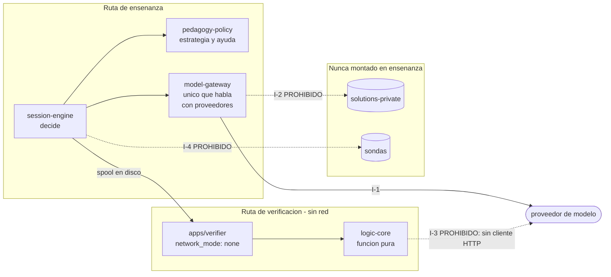

# Profesor IA · Etapa 1

Un profesor de **deducción natural proposicional** conducido por IA, construido para responder una
pregunta experimental concreta: si puede sustituir funcionalmente a un docente humano sin que nadie
lo rescate.

> **Principio rector.** La IA prepara y enseña; el código controla lo verificable; el humano autoriza
> y audita desde fuera.

Eso reparte el trabajo de forma deliberada. El modelo redacta, explica y decide *cómo* enseñar. **No
decide si una derivación es correcta** — eso lo hace un verificador determinista, sin red, sobre un
cálculo congelado y hasheado. Tampoco decide avance, modos, permisos ni consumo de bancos. Esa
frontera no es una convención: está codificada en reglas de arquitectura que fallan la compilación.

---

## Lee esto antes de tocar nada

El repositorio **no se gobierna por el código**. Hay una jerarquía, y el código está abajo:

```
1. Documento Maestro            docs_maes/…_v2.12_PostUI_PrePlan.md   (P-I / P-II / P-III)
2. Especificación UI/UX         docs_maes/…_UI_UX_v0.1_Conformada.md
3. Plan.md                      el plan de construcción ejecutable (tareas T-Hx-nn)
4. La implementación            este código
```

**Si el código contradice al plan, el código está mal. Si el plan contradice al Maestro, el plan está
mal** — y se corrige el inferior, nunca el superior. Ya ha pasado tres veces; están registradas en
«Correcciones por autoridad superior» de [`PLAN_STATUS.md`](docs/plan/PLAN_STATUS.md).

### Puntos de entrada

| Archivo | Qué es |
|---|---|
| [`docs/plan/HANDOFF.md`](docs/plan/HANDOFF.md) | **Empieza aquí.** Punto de continuación entre sesiones |
| [`docs/plan/PLAN_STATUS.md`](docs/plan/PLAN_STATUS.md) | Fuente de verdad de avance, tarea por tarea, con evidencia y las decisiones de ingeniería D-1…D-100 |
| [`CLAUDE.md`](CLAUDE.md) | Guía operativa: comandos, trampas del entorno, disciplinas |
| [`docs/gates/`](docs/gates) | Actas de gate. Un gate sin acta firmada no está cerrado |
| [`docs/blocked-by-spec.md`](docs/blocked-by-spec.md) | Decisiones normativas faltantes. Hoy vacío, a propósito |

El Maestro son 388 KB: no lo leas entero. Navega por secciones y lee sólo lo que la tarea cita.

---

## Estado

Ocho fases abiertas, ninguna cerrada del todo: **un gate se cierra con acta firmada**, y las firmas
son del propietario.

| Fase | Gate | Estado |
|---|---|---|
| F0–F2 | H0 · H1 · H2 | Tareas completas, con corrida verde observada en `main` |
| F3 | H3 · Entorno local | 5 de 5; criterio técnico cubierto. Falta Infisical y firmas |
| F4 | H4 · Pasarela de modelo | 11 de 12. **BENCH-01 corrió**: ganador provisional `claude-sonnet-5`, pero **ningún candidato aprueba los seis gates** |
| F5 | H4.5 · Investigación de fuentes | 8 de 8; corpus autorizado |
| F6 | H5 · Ingesta y autoría | 17 de 17 mecanismos; banco de **656 candidatos**. Falta W5 (firma) |
| F7 | H6 · Sesión determinista sin LLM | **14 de 14 verificadas**, AC del gate cubierto |
| F8 | H7 · Profesor IA de sesión | **7 de 7**, `ci:e2e:live-session` en verde. Falta el acta firmada |
| F9 | Cursos personalizados | 5 de 5, AC cubierto |
| F10 | H8 · Prueba funcional multimodal | 11 de 14. **Pizarrón y voz de salida montados** el 2026-08-30; línea base de accesibilidad en 9 de 11 criterios |
| F11–F16 | — | No empezadas |

**2223 pruebas unitarias** y **131 contra PostgreSQL 17 real**, más mutation testing sobre el núcleo
lógico. El detalle vive en [`PLAN_STATUS.md`](docs/plan/PLAN_STATUS.md); este resumen se queda rancio
entre sesiones y aquel no.

> **Lo que la app enseña hoy, y lo que no.** La vista de Clase opera **texto, editor Fitch, pizarrón
> y voz de salida**. Siguen sin montar cuatro capacidades, y **cada una espera algo distinto**:
> `voiceInput` espera decidir el canal de STT —el audio del alumno es dato del sujeto y el canal
> decide si sale de la máquina—; `visualBoardInterpretation` y `uiAnnotations` esperan que
> CAL-MULTIMODAL se congele; `internalUiCapture`, elegir rasterizador. Encender cualquiera de ellas
> **lanza a propósito** (`assertCapabilitiesImplemented`, `CAPACIDAD_NO_IMPLEMENTADA`): una capacidad
> declarada activa sin superficie contaminaría la matriz de autonomía de la corrida.
>
> Hasta el 2026-08-30 el pizarrón y la voz **tampoco estaban**, y la fase figuraba igualmente como
> «11 de 14, nada construible»: el recuento contaba política y no pantalla. La comprobación que lo
> destapó cabe en una línea — **quién importa el paquete** — y vale para cualquier capacidad que este
> README declare.

---

## Arquitectura

Monolito modular con procesos aislados: 25 workspaces bajo `apps/`, `packages/` y `tools/`. Las
listas de `apps/` y `packages/` son **obligatorias** (P-II §3.1): no se crean paquetes nuevos.



### Los invariantes son ejecutables, no prosa

`.dependency-cruiser.cjs` tiene trece reglas `forbidden`. Cada una codifica un invariante I-1…I-9, y
**su violación es una implementación inválida**, no un aviso de estilo:

- **I-1** — sólo `model-gateway` habla con proveedores de modelo.
- **I-2** — la pasarela, el motor de sesión, la API y la web **no alcanzan** `solutions-private/`.
- **I-3** — la ruta de verificación no importa ningún cliente HTTP ni socket. Su transporte es un
  spool en disco, y el proceso corre con `network_mode: none`.
- **I-4** — el pipeline de autoría no toca sondas ni el worker de medición.
- **I-6** — la evidencia es append-only: una corrección es un evento nuevo enlazado, y lo imponen
  triggers que niegan `UPDATE`/`DELETE` **incluso al propietario** de la tabla.
- **I-7** — toda salida factual va anclada a fragmentos autorizados.

Si añades un import y `ci:arch:depcruise` falla, **el import está mal, no la regla**.

Y cada regla lleva su **control positivo**: una violación sembrada que debe detectar. No es
ceremonia — el 2026-08-26 se descubrió así que I-1 llevaba desde el principio sin poder disparar
(D-82). «La regla existe» y «la regla detecta» son afirmaciones distintas.

---

## Puesta en marcha

Requiere Node **24.x** (`.nvmrc`), pnpm **10.x** y Docker Engine 27.x con Compose. **Todo se ejecuta
desde PowerShell**: en el Bash de Git, `$APPDATA` se expande a una ruta Windows dentro de un contexto
POSIX y el shim de pnpm no resuelve.

```bash
git clone https://github.com/MEX-AmatsuMikaboshi/profe_ia.git
```

El contenido educativo se incluye directamente en `content/unidad-deduccion-natural/`:
el clon trae el corpus, el cálculo congelado y los 413 casos del conjunto dorado que leen
`ci:unit` y `ci:logic:golden`. No requiere submódulos ni acceso a otro repositorio.

```bash
pnpm install
foreach ($c in @('ci:lint','ci:typecheck','ci:unit','ci:build')) {
  pnpm run $c; if ($LASTEXITCODE -ne 0) { throw "FALLÓ: $c" }
}
```

`&&` **no encadena** aquí: PowerShell 5.1 lo rechaza al parsear. Dentro de `package.json` sí funciona
—esos los corre pnpm en su propio shell—, pero escrito en la consola no arranca ni el primer comando.

Comprobación completa de que todo sigue en pie (~1 min sin Docker) y la tabla entera de comandos:
[`CLAUDE.md` §2](CLAUDE.md).

| Comando | Qué comprueba |
|---|---|
| `pnpm run ci:arch:depcruise` | Los invariantes I-1…I-9 |
| `node scripts/arch/verify-depcruise-catches.mjs` | Que esas reglas **detectan** trece violaciones sembradas |
| `pnpm run ci:logic:golden` | Conjunto dorado del núcleo lógico (413 casos) |
| `pnpm run ci:db:negative` | Suite negativa de privilegios contra PostgreSQL 17 real |
| `pnpm run ci:mode-separation` | Separación enseñanza/medición (12 propiedades) |
| `pnpm run ci:e2e:dry-session` | Sesión seca reconstruible desde eventos (33 propiedades) |
| `pnpm run ci:plan:status` | Coherencia de `PLAN_STATUS.md` consigo mismo |

---

## Estructura

```
apps/          web · api · verifier · authoring-worker · measurement-worker · background-worker
packages/      contratos y motores; logic-core e isomorphism-canonicalizer SEPARADOS por regla
tools/         cli (el CLI vive aquí por D-1) · bench (BENCH-01)
content/       contenido educativo versionado: corpus, cálculo congelado, conjunto dorado
infra/         compose, migraciones, runbooks
docs/          plan, gates, sesión, modelo, entorno, calidad
docs_maes/     el Maestro y la especificación UI/UX — autoridad, no documentación
analysis/      informes y artefactos derivados
```

---

## Disciplinas que no se negocian

- **No inventar.** Si falta una decisión y ninguna autoridad la resuelve, va a
  `docs/blocked-by-spec.md`, no a un valor plausible. `pendingCatalog()` rechaza todo valor en vez de
  fabricar miembros de enum.
- **Los valores `[CALIBRATION]` fallan cerrado.** Ese punto de fallo es donde se enchufa el valor
  congelado; «arreglarlo» devolviendo un número lo borra.
- **Nada de degradación silenciosa.** Un fallo no se disfraza de resultado benigno.
- **Expectativas a priori.** El conjunto dorado declara qué debe pasar *antes* de ejecutar. Grabar la
  salida observada como «esperado» convierte el conjunto en un espejo del bug.
- **Controles positivos.** Una comprobación que nunca ha visto un fallo no es evidencia de nada.
- **Una justificación se intenta refutar antes de escribirla.**
- **Nunca se versiona `.env`.** Antes de cada commit, `git status --short`.
